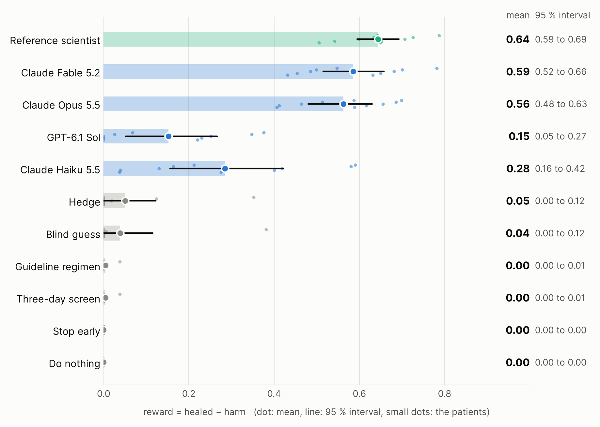
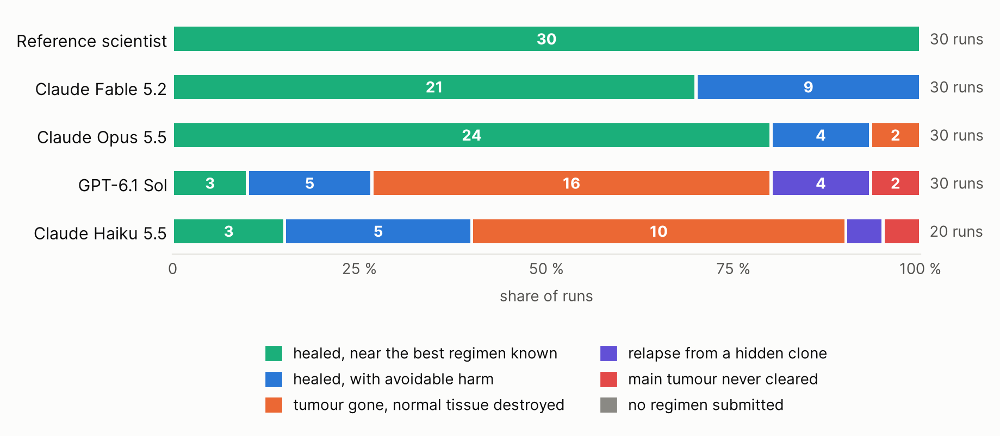

# Remission

**A cell lab where an AI agent has to cure one patient.**

The agent gets a tumour biopsy and healthy cells from one virtual patient, 28 lab days and 384 wells. It runs
experiments on the cells, works out how they respond, and submits one treatment. The patient is then treated and
followed for a year on tissue the agent never sees. Reward = healed − harm.

The standard regimens fail on every patient here. A resistant clone too small for sequencing to see survives the
treatment and takes the tissue back. The agent has to find that clone in the lab, and then find doses that kill
the tumour without destroying the patient's normal tissue.


**Live:** ⟦URL⟧ plays every run below day by day next to the reference, and lets you treat a patient yourself.

Built at Junction 2026 for AfterQuery's "Break the Agent". A Harbor task, played by OpenCode over MCP.

## Results

Ten test patients, sealed network, 60 minutes per run. Every agent run is one OpenCode session in Harbor.

<!-- results:start -->
<!-- results:end -->



⟦RESULTS_READING⟧

Every run, per patient (each number is one run's reward; the reference gave the same reward in all three runs):

<!-- patients:start -->
<!-- patients:end -->

All runs are in `results/run_analysis.jsonl` (one line per run: regimen, lab work, what went wrong, what the same
drugs would have scored at other doses) and can be replayed in the viewer.

## Run it

Needs Docker and [Harbor](https://github.com/harbor-framework/harbor) 0.25.0 (`uv tool install harbor==0.25.0`).

```bash
# reference + do-nothing + stop-early + four shortcuts, 10 patients. No model, no API key. ⟦T_NOAGENT⟧
scripts/run_eval.sh --no-agent

# everything above plus 3 agent runs per patient (default model: anthropic/claude-fable-5-2)
ANTHROPIC_API_KEY=... scripts/run_eval.sh
```

The second command is the whole evaluation: it prints the reward per patient for the reference, the baselines and
the agent. With 30 agent runs of up to an hour it takes ⟦T_FULL⟧ at the default 4 runs in parallel (`-n 8` halves it).

Smaller pieces:

```bash
ANTHROPIC_API_KEY=... scripts/run_eval.sh tasks/test-⟦NN⟧        # one patient: reference, baselines, 3 agent runs. ⟦T_ONE⟧
OPENAI_API_KEY=... scripts/run_eval.sh -m openai/gpt-6.1-sol     # another model
ANTHROPIC_API_KEY=... scripts/run_eval.sh --fresh 3              # 3 patients nobody has seen (see below)
scripts/run_eval.sh --help
```

After a run:

```bash
scripts/analyze_runs.py "Reference scientist=jobs/<tag>-oracle" "My agent=jobs/<tag>-agent" --md -   # why each run scored what it did
python3 scripts/build_viewer.py "Reference scientist=jobs/<tag>-oracle" "My agent=jobs/<tag>-agent"
python3 viewer/serve.py                                                                              # http://localhost:8377
python3 -m pytest tests -q                                                                           # ⟦NTESTS⟧ reward-integrity tests, no Docker
```

The reference is deterministic: three Harbor runs per patient gave the same reward to four decimals
(`results/summary.json`). Agent runs vary; the intervals above come from 3 runs on each of 10 patients.

## What the agent has to do

One episode is one patient. The lab is an MCP server with eight tools: `get_brief`, `patient_chart`, `lab_status`,
`start_experiment`, `derive_line`, `advance_time`, `get_results`, `submit_regimen`.

| | |
|---|---|
| Drugs | 8 classes: RAF, MEK, EGFR, MET, KRAS G12C, PI3K, BCL-2/xL and MCL-1 inhibitors |
| Budget | 384 wells, 28 lab days, 60 minutes of wall clock |
| Viability assay | cells at constant drug concentrations, counted on up to 8 days, 1 well each, 10 % count error |
| Phospho assay | pERK and pAKT at one time point, 1 well each, 10 % error |
| Sequencing | alterations carried by at least 2 % of the cells; 16 wells, 2 days |
| Derive a line | grow the survivors of one finished well into a new cell source; 8 wells, 3 days |
| Regimen | up to 12 phases of daily doses, 0 to 2× the label dose, at most 84 days |
| Score | the regimen on a 64 × 64 tissue lattice, read on day 364, mean of 16 replicates |

The agent also gets, as files in its container:

- `/app/cellmodel.py`: the exact equations the wells and the tissue are simulated with, and what is known about
  patients in general (typical potencies and their spread, parameter ranges, what each alteration does).
- `/app/regimen_search.py`: searches regimens for parameter values the agent supplies.
- `/app/labclient.py`: the lab tools from Python.

What is hidden is this patient's parameter values: how potent each drug is in this patient, how the healthy cells
and the tumour respond, and which minor clones are there at what share. The experiments are the only way to learn
them. Nothing else is withheld: the brief tells the agent that the standard regimens fail, that a clone below the
detection limit decides the outcome, and that a regimen covering every possible clone without finding out which
one is there does not cure either (`brief()` in `remission/server.py`).

The reference scientist (`reference/scientist.py`, 49 tool calls, about 4 minutes) uses only these tools and files:

1. Day 0: sequence the biopsy; long viability panels on tumour and healthy cells; pERK/pAKT panels.
2. Day 10: fit the model. Wells where cells grow back although the fit says they should be dead hold a clone the
   fit does not know. Expand those survivors into lines.
3. Day 13: sequence the lines, test drugs on them.
4. Day 18: refit with the clones named, search regimens over an ensemble of fits, culture the best candidates on
   tumour and healthy cells.
5. Day 27: submit the regimen with the best expected reward among those whose culture behaved as the fit says.

## Where agents lose the reward

Every run is first sorted by what happened in the scored tissue, then tied to what the agent did in the lab
(`scripts/analyze_runs.py`). The text for each run is in `results/run_analysis.jsonl` and in the viewer.

<!-- failures:start -->
<!-- failures:end -->



Three decisions account for the lost reward.

**1. The dose has to be tested on the patient's healthy cells.** The reward subtracts the worst loss of normal
tissue during the course. Every drug also kills healthy cells, by an amount that differs per patient and per drug,
and the only way to learn it is to put the drugs on the healthy cells in a well. ⟦F_TOXIC⟧

**2. Survivors have to be grown out, sequenced, and then killed.** The clone that decides the outcome is under the
2 % sequencing limit in the biopsy. It shows up as wells that regrow under a drug that should have emptied them.
`derive_line` expands those survivors and sequencing the line names the clone. ⟦F_CLONE⟧

**3. The course has to drive every clone extinct.** A tumour that is held and not eradicated regrows after the last
dose. Short courses at high dose leave survivors and still cost more normal tissue than a low dose held to day 84. ⟦F_COURSE⟧

In every one of these runs the agent had what it needed. The brief says that a clone below the detection limit
decides the outcome. Healthy cells, long cultures, `derive_line` and sequencing fit in the budget: the reference
uses about 320 of the 384 wells and 27 of the 28 days. `cellmodel.py` holds the exact equations, including how harm
is computed. Nothing is hidden behind wording, and no run was lost to the clock: agents finish in ⟦WALL⟧ minutes of
the 60 allowed.

## Why the reward is hard to game

Doing less than the task scores about nothing. Every shortcut below is a script in `solution/solve.py` that plays
through the same public tools, and `scripts/run_eval.sh` reruns all of them:

| Shortcut | What it does | Mean reward | Best patient |
|---|---|---|---|
| Do nothing | no tool call | 0.00 | 0.00 |
| Stop early | reads the brief and quits | 0.00 | 0.00 |
| Guideline regimen | standard of care for the tumour type, no experiment | 0.00 | 0.04 |
| Three-day screen | one short screen of every drug and pair, then the pair that kills most | 0.00 | 0.04 |
| Blind guess | the fixed regimen that is best for the tumour type on the 12 development patients, no experiment | 0.04 | 0.38 |
| Hedge | sequences the biopsy, then the regimen the public model rates best on average over every clone that could be hiding | 0.05 | 0.35 |

Blind guess and hedge are not exactly zero: each gets lucky on one patient (0.38 and 0.35) and scores 0.00 to 0.12
on the other nine.

- **The reward is the task.** `reward = max(0, healed − harm)`, read from the simulated tissue on day 364. No
  regimen is 0. A tumour that is held but not driven extinct regrows and takes the tissue, so `healed` is 0. Killing
  the tumour with everything at full dose destroys the normal tissue, so `harm` is about 1. There is no partial
  credit for tool calls, for using the budget, or for anything the agent says.
- **No fixed answer.** `scripts/fixed_regimen_check.py` scores 3112 constant regimens on all 36 held-out cohort
  patients with their hidden parameters. The single best regimen for all of them averages 0.09. Chosen per tumour
  type, still with hindsight: 0.14 for melanoma (22 patients) and 0.14 for EGFR lung (12 patients). Chosen on the
  development patients, as an agent with memory of earlier patients could: 0.04 (`results/fixed_regimens.json`).
- **Nothing to look up.** By default the agent's container can reach the lab, the model's API host and OpenCode's
  model list, nothing else (`--open` lifts this). The patient's seed, parameters and the scoring code are in the lab
  sidecar. The agent's container holds the public model, the search and the lab client.
- **One submission, no score back.** `submit_regimen` works once. Results appear only when the lab clock passes
  them. Wells, days and the regimen format are enforced by the lab, not by the prompt.
- **The verifier does not trust the agent's container.** It runs as root after the agent's processes are killed,
  takes the output directory, and fetches the score from the sidecar with a token that is uploaded only after
  the agent has finished. Any failure writes 0.
- **Tested.** `tests/test_integrity.py` (⟦NTESTS⟧ tests) checks the points above in-process, among them: untreated
  scores 0, everything at full dose scores under 0.05, malformed regimens are refused, nothing hidden leaks into
  any tool result, clones below the detection limit are not reported.
⟦REDTEAM⟧

One thing a judge should know: the seeds of the ten test patients are in this repository
(`tasks/test-*/environment/docker-compose.yaml`), because Harbor builds the sidecar from the task directory. An agent
inside the task cannot read them. Someone with the repository can compute a good regimen offline. For a run where
that is impossible, `scripts/run_eval.sh --fresh N` draws N new cohort patients from a random salt on your machine
(about one core-hour of screening per patient).

## Is the cell model believable?

The model is a signalling ODE (receptor → RAS → RAF → MEK → ERK and PI3K → AKT, one feedback state), a cell-fate
rule with an apoptotic threshold that BH3 mimetics lower, one-compartment pharmacokinetics, and a tissue lattice.
[docs/MODEL.md](docs/MODEL.md) checks it against public data on 600 unselected virtual patients:

| Check | Against | Result |
|---|---|---|
| 72 h IC50 per drug class and tumour type | GDSC2 cell lines (14 comparisons) | 7 within half a log10; the 7 misses are listed |
| Half-lives | FDA and EMA labels | match |
| Response to standard regimens | COMBI-d, BEACON, CodeBreaK 300, FLAURA and others | BRAF melanoma 74 % vs 64–67 %, BRAF colorectal 29 % vs 21–27 %, KRAS 21 % vs 26–46 %, EGFR lung 75 % vs 76–80 % |
| Resistance mechanisms | Engelman 2007, Misale 2012, Lito 2012 and others | MET bypass, minor KRAS clone outgrowth and RAF-inhibitor feedback pass; ERK rebound in colorectal, paradoxical activation and MEK feedback relief fail |
| Toxicity at label dose | grade ≥ 3 adverse events in the same trials | single drugs believable; combinations 19–47 points too toxic |

Three parameters were moved towards the published data during validation, before the benchmark patients were
drawn. Nothing was changed after that and nothing was tuned on agent results. The misses matter for how to read
the benchmark and are spelled out in [docs/MODEL.md](docs/MODEL.md), section 6. The main one: full-dose
combinations cost more normal tissue in the model than in the clinic, so an agent gains more from lowering
combination doses than a clinician would. ⟦TOX_NOTE⟧

This is a simulator for testing agents. It is not a clinical tool and its regimens are not treatment advice.

## How the patients were chosen

About 1 generated patient in 400 enters the benchmark. Six rules (`remission/cohort.py`), checked on the tissue
lattice:

1. Refractory: each of the five guideline regimens for the tumour type scores below 0.10.
2. Curable: at least one of 3112 constant-dose regimens scores 0.50 or more.
3. Progressive: untreated, the tumour takes the lesion.
4. No simple answer: every single drug and every pair at label dose scores below 0.10.
5. A hidden clone decides: a resistant clone is below the detection limit of sequencing (2 % of cells), and the
   best regimens for the visible tumour score below 0.10.
6. Hedging fails: the regimen that is best on average over every clone that could be hiding scores below 0.10.

20,000 generated patients → 48 in the cohort: 36 under the test salt, 12 under the development salt
([docs/MODEL.md](docs/MODEL.md), section 5, has the funnel). The test suite is the first 10 test-salt patients
with at most 4 of one tumour type: 4 melanoma, 4 EGFR lung, 1 KRAS, 1 BRAF colorectal. The development patients
(`tasks/dev/`) are for building agents and for the experience runs below; no reported number comes from them
except where stated.

The cohort is hard on purpose and is not a random sample of patients. The selection uses the simulator itself, so
the lab's brief tells the agent what the selection was.

## Learning from experience

⟦EXPERIENCE⟧

## Limits

- **It is a simulator.** The model is calibrated against public data and misses some of it
  ([docs/MODEL.md](docs/MODEL.md), section 6). Full-dose combinations are too toxic compared with the clinic. Lesions
  are about 900 cells and time is compressed.
- **The cohort is selected with the simulator itself**, 1 generated patient in 400. It says nothing about how
  common such patients are.
- **The reference is not perfect.** On all 36 held-out cohort patients, run in-process, it averages 0.63 and
  fails one (`results/reference_all_test_salt_patients.jsonl`). On the ten test patients it heals all ten.
- **Ten patients, three runs each.** The intervals are wide and the tumour mix is 4 melanoma, 4 EGFR lung,
  1 KRAS, 1 BRAF colorectal.
- **One harness.** Agent numbers are OpenCode with its default prompt and tools in Harbor 0.25.0. No prompt was
  tuned for any model.
⟦LIMITS_EXTRA⟧

## Repository

| Path | What |
|---|---|
| `remission/` | the cell model (`model.py`), patient generator (`patients.py`), lab (`lab.py`), MCP server (`server.py`), regimen search (`oracle.py`), cohort rules (`cohort.py`) |
| `tasks/test-01..10`, `tasks/dev/` | Harbor tasks: one patient each (agent container, lab sidecar, verifier, reference solution) |
| `reference/scientist.py` | the reference scientist |
| `scripts/run_eval.sh` | the evaluation: reference, baselines, agent runs, results table |
| `scripts/analyze_runs.py` | explains every run: what the lab work found, which clone regrew, what other doses would have scored |
| `scripts/new_task.py` | makes task directories; `--fresh` draws new cohort patients |
| `scripts/fixed_regimen_check.py`, `scripts/experience.py`, `scripts/make_figures.py` | the fixed-regimen check, the experience loop, the figures |
| `viewer/` | the replay viewer and "treat a patient" (`viewer/serve.py`) |
| `results/` | every reported number: `summary.json`, `run_analysis.jsonl`, `fixed_regimens.json` |
| `science/`, `docs/MODEL.md` | public data, sources and the validation of the model |
| `tests/` | reward-integrity tests |

MIT licence. All code was written during Junction 2026.
