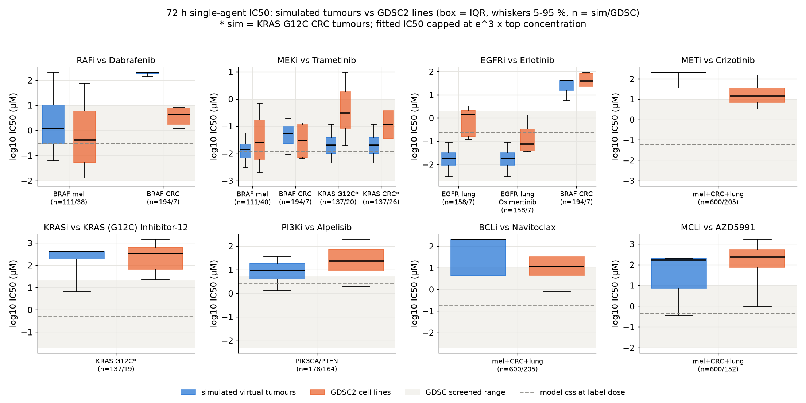
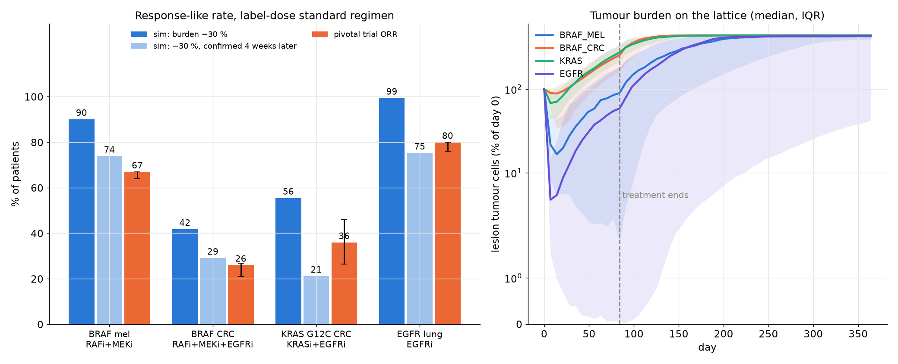
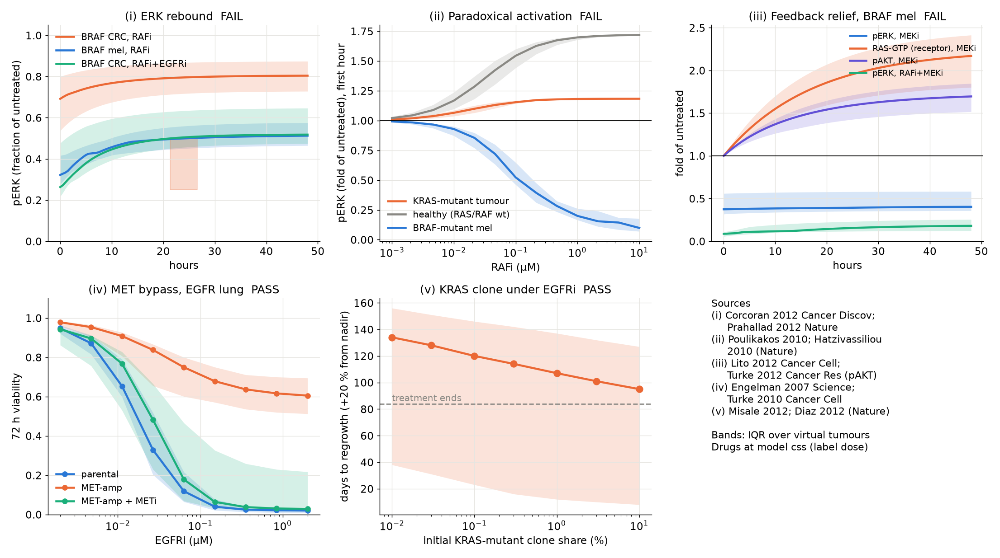
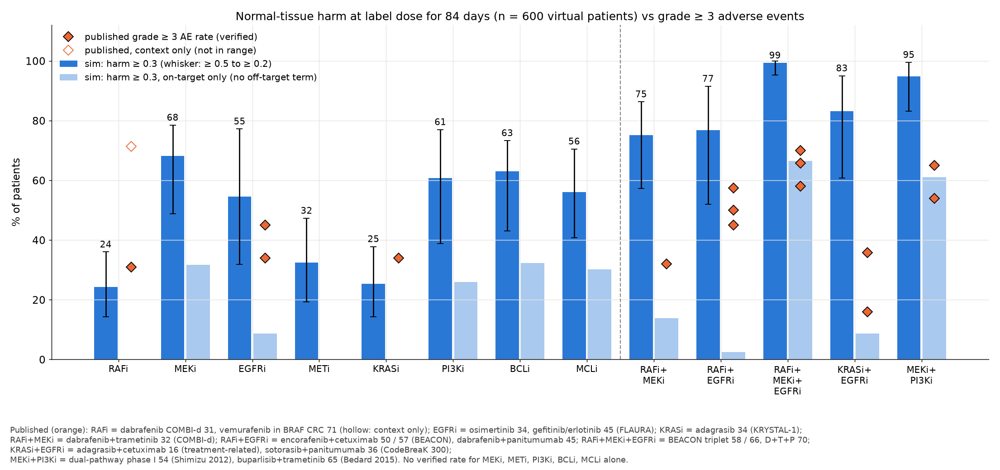
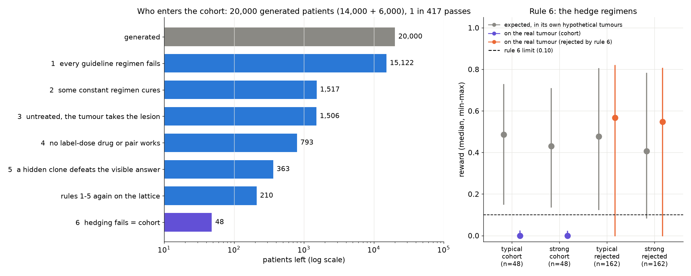

# The Remission cell model: validation

Every number below comes from `docs/validation.json` or from the code in `remission/`. The validation population is 600 unselected virtual patients, `make_patient(seed_from("validation", i))` for i = 0..599: 194 BRAF-mutant colorectal (BRAF CRC), 111 BRAF-mutant melanoma (BRAF mel), 137 KRAS G12C colorectal (KRAS), 158 EGFR-mutant lung (EGFR).

## 1. What the model is

1. Each cell population ("clone") has 14 parameters. Signalling is an algebraic receptor → RAS → RAF → MEK → ERK and PI3K → AKT network plus one slow feedback state F (τ = 0.75 d) that raises receptor input when ERK falls.
2. RAF inhibitors paradoxically activate wild-type RAF dimers when RAS is active.
3. Cell fate: proliferation follows ERK and AKT. Apoptosis switches on when the death drive exceeds an anti-apoptotic buffer `bcl`, which BCL-2/xL and MCL-1 inhibitors shrink.
4. Tumour cells are primed: `bcl` = 1.30–2.00 × their untreated death drive, 1.69–2.60 × for BRAF CRC. Healthy cells: 1.6–2.6 ×.
5. Eight drug classes. Occupancy is `c/(c + K·kshift)`. K varies between patients (sd of ln K = 0.8). `kshift` encodes resistance mutations.
6. Pharmacokinetics: one compartment, once-daily dosing, label half-lives. Dose 1.0 gives an average concentration `css`.
7. Tissue: a 64 × 64 lattice with a central lesion of about 900 tumour cells. Treatment runs on days 0–83; the tissue is read on day 364.
8. Harm: every drug also kills normal cells off-target (median 0.02/day at `css`, sd of ln = 1.2 per drug and patient). `harm` is the largest fractional loss of the patient's normal tissue. Reward = healthy share on day 364 − harm.

## 2. What is calibrated against what

Three parameters were moved towards the published data during this validation, before the benchmark patients were drawn. Nothing was changed after that, and nothing was tuned on agent results.

- PI3Ki: K 0.20 → 1.0 µM and `css` 0.50 → 2.5 µM (the 72 h IC50 was 1.27 log10 below alpelisib's).
- MCLi: K 0.030 → 0.18 µM and `css` 0.075 → 0.45 µM (0.78 log10 below AZD5991's).
- BRAF CRC tumour buffer × 1.3, margin 1.69–2.60 (the confirmed response to the triplet was 57 %, against 21–27 % in BEACON).

The first two scale K and `css` together, so occupancy in tissue is unchanged. Only the in-vitro IC50 moves.

### a. 72 h potency vs GDSC2



Each virtual tumour gets a 9-point, 72 h viability curve over the GDSC range of the matching compound, fitted with GDSC's two-parameter sigmoid. The table gives median log10 IC50 in µM, the share of IC50s above the top tested concentration, and median AUC. A fitted IC50 is capped at e³ × the top concentration, so a median at the cap means "mostly inactive".

| Class vs GDSC compound | Sim group / GDSC group (n lines) | Sim | GDSC | Δ log10 | Above range sim / GDSC | AUC sim / GDSC |
|---|---|---|---|---|---|---|
| RAFi vs dabrafenib | BRAF mel / BRAF V600E melanoma (38) | 0.08 | −0.38 | +0.46 | 25 % / 21 % | 0.65 / 0.53 |
| RAFi vs dabrafenib | BRAF CRC / BRAF V600E CRC (7) | 2.30 (cap) | 0.63 | **+1.68** | 100 % / 14 % | 1.00 / 0.75 |
| MEKi vs trametinib | BRAF mel / BRAF V600E melanoma (40) | −1.86 | −1.61 | −0.26 | 0 % / 3 % | 0.38 / 0.47 |
| MEKi vs trametinib | BRAF CRC / BRAF V600E CRC (7) | −1.26 | −1.53 | +0.26 | 0 % / 0 % | 0.58 / 0.49 |
| MEKi vs trametinib | KRAS / KRAS G12C, any solid (20) | −1.70 | −0.52 | **−1.17** | 0 % / 40 % | 0.44 / 0.73 |
| MEKi vs trametinib | KRAS / KRAS-mutant CRC (26) | −1.70 | −0.94 | **−0.75** | 0 % / 12 % | 0.44 / 0.65 |
| EGFRi vs erlotinib | EGFR / EGFR-mutant NSCLC (7) | −1.76 | 0.14 | **−1.90** | 0 % / 29 % | 0.32 / 0.65 |
| EGFRi vs osimertinib | same | −1.76 | −1.13 | **−0.63** | 0 % / 29 % | 0.32 / 0.59 |
| EGFRi vs erlotinib | BRAF CRC / BRAF V600E CRC (7) | 1.60 | 1.59 | +0.02 | 100 % / 100 % | 0.92 / 0.96 |
| KRASi vs KRAS (G12C) Inhibitor-12 | KRAS / KRAS G12C, any solid (19) | 2.60 | 2.52 | +0.08 | 91 % / 95 % | 0.93 / 0.95 |
| PI3Ki vs alpelisib | PIK3CA/PTEN-altered / same, any solid (164) | 0.96 | 1.37 | −0.41 | 70 % / 85 % | 0.94 / 0.93 |
| MCLi vs AZD5991 | all / mel + CRC + NSCLC (152) | 2.23 | 2.37 | −0.14 | 72 % / 89 % | 0.91 / 0.97 |
| BCLi vs navitoclax | all / mel + CRC + NSCLC (205) | 2.30 (cap) | 1.07 | **+1.23** | 69 % / 54 % | 0.89 / 0.91 |
| METi vs crizotinib | all / mel + CRC + NSCLC (205) | 2.30 (cap) | 1.16 | +1.14 | 97 % / 60 % | 1.00 / 0.90 |

Seven of 14 comparisons are within half a log10, PI3Ki and MCLi among them after their change (AUC within 0.07). The BRAF CRC buffer change moved MEKi in BRAF CRC from −0.10 to +0.26 and pushed the median BCLi IC50 from +0.36 to the cap (+1.23). Its AUC still matches (0.89 vs 0.91): the jump is the median of a bimodal set crossing the edge of the tested range. The misses are listed in section 6.

### b. Pharmacokinetics vs drug labels

Half-lives follow the labels. `css` is an effective concentration in well units. It is not a measured free plasma level.

| Class | Model t½ (h) | Label t½ (h) | Model css (µM) | Label Cavg total / free (µM) | css ÷ free |
|---|---|---|---|---|---|
| RAFi | 8 | 8 (dabrafenib) | 0.30 | 0.70 / 0.002 | 144 |
| MEKi | 96 | 127 (trametinib SmPC; FDA 94–115) | 0.012 | 0.025 / 0.0007 | 18 |
| EGFRi | 36 | 36.2 (erlotinib) | 0.24 | 3.55 / 0.25 | 0.96 |
| METi | 6.5 | capmatinib 6.5 (unverified) | 0.06 | – | – |
| KRASi | 24 | adagrasib ~23–24 (unverified) | 0.50 | – | – |
| PI3Ki | 9 | 8–9 (alpelisib) | 2.5 | 3.14 / 0.34 | 7.3 |
| BCLi | 17 | 17.1 (navitoclax) | 0.175 | 2.50 (day 1) / unverified | – |
| MCLi | 12 | no approved drug | 0.45 | – | – |

PI3Ki `css` is 0.80 × total plasma Cavg and 7.3 × free.

### c. Standard regimens vs trial response rates



Each tumour type gets its first `cohort.GUIDELINES` regimen at label dose for 84 days, on the lattice, 2 replicates per patient. A response is a tumour-cell count ≤ 70 % of day 0, either at any time or again 28 days later ("confirmed").

| Type | Regimen | Sim −30 % | Sim confirmed | Trial ORR |
|---|---|---|---|---|
| BRAF mel | RAFi+MEKi | 90 % | 74 % | 64–67 % (COMBI-d/v) |
| BRAF CRC | RAFi+MEKi+EGFRi | 42 % | **29 %** | 21–27 % (BEACON triplet; Corcoran 2018) |
| KRAS G12C CRC | KRASi+EGFRi | 56 % | 21 % | 26–46 % (CodeBreaK 300; KRYSTAL-1) |
| EGFR lung | EGFRi | 99 % | 75 % | 76–80 % (FLAURA) |

The confirmed rate is within 10 points of the trials for all four types. BRAF CRC is 2 points above the top of its range.

## 3. Mechanistic checks against the classic papers



Drugs are at label-dose `css`; values are medians over tumours of the type. The pass rules were written before the first run. None of these papers gives fold changes as numbers in the text, so the checks are qualitative. The three parameter changes of section 2 do not touch signalling.

| Check | Result | Key numbers |
|---|---|---|
| (i) ERK rebound in BRAF CRC, not melanoma; EGFRi stops it (Corcoran 2012; Prahallad 2012) | **FAIL** | CRC pERK 0.70 at t=0 → 0.81 at 24 h (paper: deep nadir, then 0.25–0.50 at 24 h). Melanoma 0.30 → 0.44. CRC on RAFi+EGFRi 0.56 at 24 h. Right direction; CRC nadir far too shallow. |
| (ii) Paradoxical activation (Poulikakos 2010; Hatzivassiliou 2010) | **FAIL** (rule: KRAS-mutant > 1.2×) | KRAS-mutant tumour 1.19×, healthy cells 1.72×, BRAF mel 0.37 at css. Mutant-KRAS ERK is near saturation. |
| (iii) Feedback relief after MEKi (Lito 2012; Turke 2012) | **FAIL** | pERK 0.36 → 0.40 at 48 h: no real rebound. RAS-GTP 1.68× at 12 h, 2.0× at 24 h. pAKT 1.63× (as in Turke). RAFi+MEKi 0.11 vs 0.44 for RAFi (as in Lito). |
| (iii-b) Lito's experiment: RAFi in melanoma | PASS | pERK 0.30 → 0.39 (8 h) → 0.44 (24 h) → 0.46 (48 h). But RAS-GTP is already 1.72× at 12 h; Lito saw no rise at 12 h. |
| (iv) MET bypass (Engelman 2007; Turke 2010) | PASS | MET amplification shifts the EGFRi IC50 195×; METi at css brings it back to 1.3×. |
| (v) Minor KRAS clone under EGFRi (Misale 2012; Diaz 2012) | PASS | Regrowth comes 19 days sooner per 10× larger starting share: 65 days at 0.01 %, 11 days at 10 %. The KRAS clone is ≥ 99.9 % of the tumour at regrowth. |

## 4. Toxicity at the labelled dose



All 600 validation patients get each class alone and five standard combinations, every drug at dose 1.0 for 84 days. `harm` comes from `model.regimen_course`. It depends only on the patient's healthy cells and potencies, not the tumour type. "Large harm" means harm ≥ 0.30, i.e. at least 30 % of the normal tissue lost at some point. This is compared with the share of trial patients who had any grade ≥ 3 adverse event. The rule, fixed before the run: believable if the simulated share lies within the published range ± 10 points. Sources and verification status are in `science/SOURCES.md` (section "Toxicity comparators").

| Model regimen | Sim harm ≥ 0.3 | Same, on-target only | Sim harm ≥ 0.8 | Published grade ≥ 3 AE | Verdict |
|---|---|---|---|---|---|
| RAFi | 24 % | 0 % | 7 % | 31 % dabrafenib (COMBI-d) | believable |
| MEKi | 68 % | 32 % | 29 % | trametinib: unverified | – |
| EGFRi | 55 % | 9 % | 14 % | 34 % osimertinib, 45 % gefitinib/erlotinib (FLAURA) | believable (+9.5, at the edge) |
| KRASi | 25 % | 0 % | 6 % | 34 % adagrasib (KRYSTAL-1, treatment-related) | believable |
| METi / PI3Ki / BCLi / MCLi | 32 / 61 / 63 / 56 % | 0 / 26 / 32 / 30 % | 9 / 21 / 26 / 26 % | none verified | – |
| RAFi+MEKi | 75 % | 14 % | 35 % | 32 % (COMBI-d) | **too toxic, +43** |
| RAFi+EGFRi | 77 % | 3 % | 28 % | 45–57 % (BEACON doublet; Corcoran 2018) | **too toxic, +19** |
| RAFi+MEKi+EGFRi | 99 % | 67 % | 83 % | 58–70 % (BEACON triplet; Corcoran 2018) | **too toxic, +29** |
| KRASi+EGFRi | 83 % | 9 % | 32 % | 16–36 % (KRYSTAL-1; CodeBreaK 300, treatment-related) | **too toxic, +47** |
| MEKi+PI3Ki | 95 % | 61 % | 64 % | 54 % dual-pathway phase I (Shimizu 2012); 65 % buparlisib+trametinib (Bedard 2015) | **too toxic, +30** |

Single agents are in a believable range. Combinations are not. They are 19–47 points too toxic at the 0.3 threshold.

The ordering is partly right. The triplet and MEK+PI3K are the most toxic in both model and trials, and Shimizu's dual-pathway rate (54 %) is three times the single-pathway rate (18 %). But two real combinations are about as tolerable as one of their drugs alone: dabrafenib+trametinib 32 % vs dabrafenib 31 %, and adagrasib+cetuximab 16 % vs adagrasib 34 %. The model cannot show that. Its off-target term is drawn independently for each drug and adds up. The "on-target only" column shows this: without the off-target term, RAFi+MEKi and KRASi+EGFRi cause large harm in only 14 % and 9 %.

No threshold fits both groups. At harm ≥ 0.8 the combinations come closer (28–83 %), but single agents fall to 6–14 %. The model also has no dose reductions or interruptions, which trials use constantly. Its harm can reach 1.0, total loss of the normal tissue; real fatal toxicity is rare. A model share is also not the same quantity as a trial AE rate: trial rates mix causes and grades, and some count only treatment-related events.

What this means for the benchmark: reward subtracts harm, so full-dose combinations cost more in the model than in the clinic. An agent gains by lowering combination doses. Nothing was tuned.

## 5. The benchmark cohort



A generated patient enters the benchmark only if all six rules of `remission/cohort.py` hold:

1. Refractory: each of the five guideline regimens for the tumour type scores below 0.10.
2. Curable: at least one of 3112 constant-dose regimens scores 0.50 or more.
3. Progressive: left untreated, the tumour takes the lesion.
4. No simple answer: every single drug and every pair at label dose scores below 0.10.
5. A hidden clone decides: a resistant clone is below the detection limit of sequencing (2 % of cells), and the best regimens for the visible tumour score below 0.10.
6. Hedging fails: the regimen best on average over every clone that could be hiding scores below 0.10.

Rules 1 to 5 are checked on the fast model, then on the lattice. Patients left after each step:

| Step | Test salt | Development salt | Both |
|---|---|---|---|
| Generated | 14,000 | 6,000 | 20,000 |
| Rule 1 | 10,568 | 4,554 | 15,122 |
| Rule 2 | 1,066 | 451 | 1,517 |
| Rule 3 | 1,060 | 446 | 1,506 |
| Rule 4 | 570 | 223 | 793 |
| Rule 5 | 257 | 106 | 363 |
| Rules 1 to 5 on the lattice | 150 | 60 | 210 |
| Rule 6: the cohort | 36 | 12 | 48 |

About 1 generated patient in 400 passes (1 in 417). Of the 48, 27 are melanoma, 16 EGFR lung, 3 KRAS and 2 BRAF colorectal. The hidden clone is most often BCL-xL (20) or MCL-1 (17); 13 have two. The best constant regimen scores 0.50 to 0.72 (median 0.57). Rule 6's hedges expect a median of 0.49 and 0.43 (typical and strong clones) in their own worlds but score at most 0.02 on the real tumour.

The cohort is hard on purpose. These are the patients functional precision oncology exists for: the tumour comes back from cells below the detection limit of sequencing. It is not a random sample and says nothing about how common they are. The selection uses the simulator itself, so the lab's brief tells the agent how the patients were chosen (`cohort` in `brief()`, `remission/server.py`).

The test suite is the first 10 test-salt patients with at most 4 of one tumour type: 4 melanoma, 4 EGFR lung, 1 KRAS, 1 BRAF colorectal. The development set is all 12 of the development salt (`tasks/dev/`). Both are in `tasks/suites.json`.

Per tumour type, the constant regimen with the best mean over the 12 development patients (`reference/fixed_regimens.json`, `hindsight`) scores 0.28 to 0.48 on 4 of the 36 test-salt cohort patients and about 0 on the rest, mean 0.04. Chosen with hindsight on those 36, the best constant regimen per type averages 0.14 for melanoma (n = 22) and 0.14 for EGFR lung (n = 12); the best single one for all 36 averages 0.09.

`scripts/run_eval.sh --fresh N` draws N new patients from a random salt, roughly one core-hour per patient.

## 6. Known mismatches and abstractions

**Mismatches with published data**

- **BRAF CRC on RAFi alone is too resistant in vitro.** 100 % of virtual tumours have IC50 above the dabrafenib range, against 14 % of 7 GDSC lines.
- **MEKi is too potent in KRAS tumours.** They are as sensitive as BRAF tumours. KRAS lines in GDSC are 6–15× less sensitive. A structural term would be needed (mutant RAS also driving PI3K); untested.
- **EGFRi is too potent in EGFR lung.** The gap is 0.63 log10 even against osimertinib. The GDSC group has only 7 lines and includes T790M and PTEN-null lines.
- **BCLi and MCLi responses are bimodal.** A primed minority responds strongly and most tumours do not respond. GDSC is mostly weak. With the BRAF CRC change the BCLi median moved to the cap (+1.23).
- **METi vs crizotinib** (+1.14) is not a MET test; crizotinib acts off-target in GDSC.
- **ERK dynamics (checks i–iii).** The CRC nadir is too shallow. Feedback is too fast: RAS-GTP rises by 12 h, Lito saw it only by 24–48 h. MEKi gives no real pERK rebound.
- **Paradoxical activation** is too weak in KRAS-mutant tumours (1.19×), though present in healthy cells (1.72×).
- **KRAS** confirmed response (21 %) is 5 points under CodeBreaK 300; BRAF CRC (29 %) is 2 points over BEACON.
- **Combination toxicity** is too high (section 4).

**Deliberate abstractions**

- **Lesion size.** A lesion is about 900 cells; a real one is around 10⁹. So some unselected patients are eliminated: 29 % of EGFR lung and 20 % of BRAF mel by day 364 (5 % of BRAF CRC, 1 % of KRAS). Real metastatic disease is almost never eradicated by these drugs.
- **Compressed time.** Median time to regrowth on the lattice is 19–25 days, against median PFS of 4–11 months. 64–99 % of patients regrow before day 84, while still on treatment.
- **Concentrations.** `css` is an effective well concentration, not free plasma. RAFi and MEKi sit 144× and 18× above free plasma levels, PI3Ki 7.3×, EGFRi 0.96×.
- **Drug classes.** There are eight classes, not eight molecules. Potency per patient is drawn around one class value.
- **Response.** A lattice cell count is not a RECIST measurement. A virtual population is not a trial population.
- **Toxicity.** One renewing normal tissue stands in for all organs. There are no dose reductions.

## 7. How to regenerate

```
nice -n 10 science/.venv/bin/python science/validation/validate_model.py      # --n 600 --lattice-reps 2 --procs 16; about 2 min
```

It writes `docs/validation.json` and `docs/img/val_*.png`. Part e (cohort) reads `science/cohort_scan_summary.json`, which `science/validation/cohort_summary.py` writes from the cohort scan results. The JSON and the cohort figure say "stale" when the scan is older than the model code.
